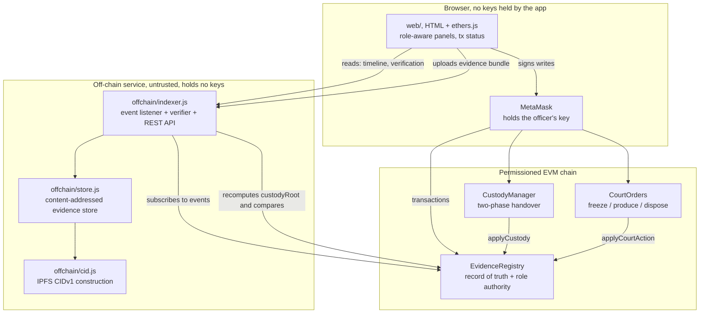
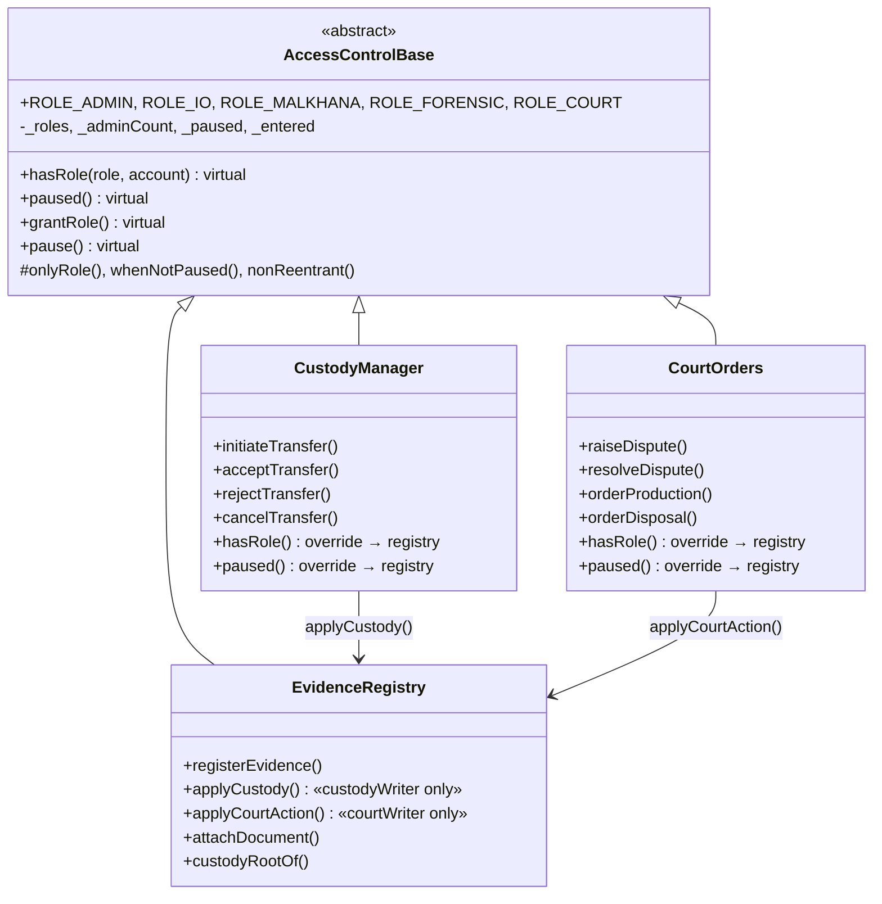
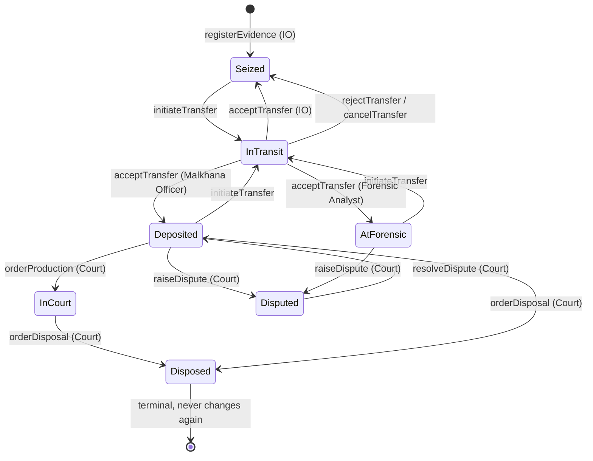
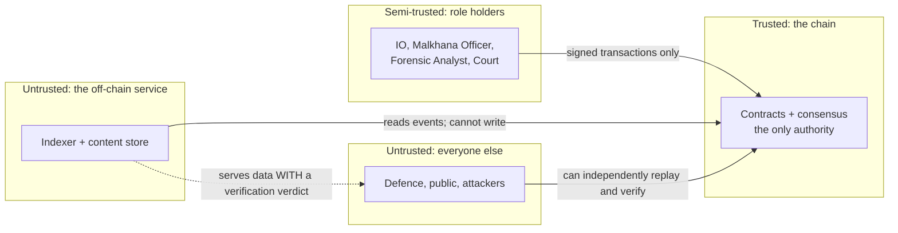

# Architecture

## 1. The problem in one paragraph

Under Police Rules 1934 r. 22.70, every item seized in a criminal case is
entered in **Register No. XIX** and deposited in the police station's
**malkhana**. That register is a paper book, kept by the Malkhana Officer, in
the same building as the evidence. The chain of custody it records is the basis
on which an item becomes admissible, yet the person who writes it is the same
person whose conduct is in question when the item is challenged. The defence has
no way to verify it, and a later entry can be written in an earlier hand.

This system does not try to replace the malkhana. It replaces the *register*
with a record no single party can silently rewrite, and that any party,
including the defence, can verify independently.

## 2. Component diagram



Look at the arrow from `IDX` back to `REG`, the one labelled *recomputes*. Our
indexer is not trusted, so it has to prove its own output. Section 6 covers how.

## 3. Contract interaction and inheritance



### Why inheritance, and why this inheritance

All three contracts need the same role checks, the same emergency stop and the
same reentrancy guard. Copying that into three files would mean three places to
get it wrong. So the behaviour lives once in `AccessControlBase`.

But a naive base class would give each contract **its own** role table, meaning
every officer would have to be granted their role three separate times, and that
is three chances for the three tables to drift apart. So `hasRole()` and `paused()` are
declared **`virtual`**, and `CustodyManager` and `CourtOrders` **override** them
to read `EvidenceRegistry` instead:

```solidity
function hasRole(bytes32 role, address account) public view override returns (bool) {
    return registry.hasRole(role, account);
}
```

The result is one role authority and one pause switch for the whole system.
`grantRole`, `revokeRole`, `pause` and `unpause` are overridden in those two
contracts to **revert**, so there is no dead table that looks writable
(`RolesManagedByRegistryError`, `PauseManagedByRegistry`). This is inheritance
inheritance sharing behaviour and redirecting a hook.

### Why the work is split across three contracts

| Contract | Responsibility | Why separate |
|---|---|---|
| `EvidenceRegistry` | the record itself, and the role authority | Must outlive workflow changes. A bug in a workflow contract must not be able to rewrite history. |
| `CustodyManager` | the day-to-day two-phase handover | The high-frequency, lowest-privilege path. Authorised only as `custodyWriter`, so it can never freeze or dispose. |
| `CourtOrders` | freeze, produce, dispose | Holds the dangerous powers. Authorised only as `courtWriter`, and it is the *only* contract that can touch a frozen or terminal record. |

The two authorisations are separate mappings on the registry
(`custodyWriter` / `courtWriter`). If `CustodyManager` were ever compromised, it
still could not dispose of evidence; the admin can revoke it with one call
(`test/03-attacks.test.js` proves this).

## 4. The custody lifecycle



The resulting status after `acceptTransfer` is derived from the **receiver's
role**, not from anything the sender claims. An address with no custody-capable
role cannot be a transfer target at all, which is checked at *initiate* time so
an item is never stranded in transit toward an address that cannot accept it.

## 5. On-chain / off-chain data map

| Data | Where | Why |
|---|---|---|
| Evidence id, case id (hashed FIR) | **on-chain** | the identity of the record |
| `itemHash`, digest of the sealed-item photo/document set | **on-chain, write-once** | this is the anti-substitution commitment; it has no setter |
| Current holder, status, step count | **on-chain** | the answer to "who has it right now" must be authoritative |
| `custodyRoot`, rolling hash over the whole trail | **on-chain** | lets anyone verify an off-chain copy of the trail |
| `cidDigest`, 32-byte sha2-256 digest of the evidence bundle | **on-chain** | commits to the file without paying to store it |
| Full custody trail (who, when, what action) | **events to off-chain index** | gas optimisation 2; integrity guaranteed by `custodyRoot` |
| Evidence bundle itself (photos, seizure memo, PFSA report) | **off-chain content store** | far too large for chain storage |
| Full IPFS CIDv1 string | **recomputed off-chain** | derivable from the digest; storing the string costs ~5 slots |
| Officer names, CNICs, complainant details, case narrative | **nowhere in this system** | the brief forbids personal data on-chain, and a public custody ledger has no need of it, addresses are pseudonymous role-holders |

**Nothing personally identifying is written on-chain.** An FIR number is hashed
into `bytes32`. Officers appear only as addresses holding roles.

## 6. Trust boundaries



- **The chain is the authority.** Everything else derives from it.
- **Role holders are semi-trusted.** They are authorised to act, and the whole
  design assumes one of them may be the adversary. That is why custody cannot be
  pushed without acceptance, why `itemHash` has no setter, and why timestamps
  come from `block.timestamp` and never from the caller.
- **The off-chain service is not trusted at all.** It holds no keys, can write
  nothing, and every record it serves carries a `verification` object with the
  on-chain root, its own replayed root, and a verdict. A client that does not
  trust the indexer can fetch the same public events and recompute.
- **The defence is a first-class reader.** This is the point of the project. A
  defence lawyer can verify the custody trail without asking the police for
  permission.

### How the integrity proof works

Each custody step extends a rolling hash stored on-chain:

```
custodyRoot[n] = keccak256(abi.encode(
    custodyRoot[n-1], id, actor, newHolder, newStatus, action, timestamp))
```

The indexer replays every `CustodyRecorded` event and recomputes the chain. If
an entry is **omitted**, **altered** or **reordered**, the recomputed root
diverges from the on-chain value and the record is reported as unverified, with
`divergedAtSeq` naming the first bad step. All three detections are proven in
`test/04-integrity.test.js`.

The content store applies the same idea to files: every file is named by its own
CID, and is re-hashed on read. A file altered on disk returns **HTTP 409
`INTEGRITY_FAILURE`**, not data.

### Failure conditions

| Failure | Behaviour |
|---|---|
| Chain unreachable | `/api/health` reports `degraded: true`; the last good index is served but flagged |
| Indexer missed events | replayed root diverges to record served as **UNVERIFIED** |
| Evidence file lost from the store | record still verifiable; `bundle.held: false` states the digest exists on-chain but the content is not held |
| Evidence file altered on disk | HTTP 409 with the digest it now hashes to |
| External disposal handler reverts | court order still recorded; `DisposalNotificationFailed` emitted |
| Last admin about to be removed | reverts with `LastAdmin`, so the system cannot be bricked |
