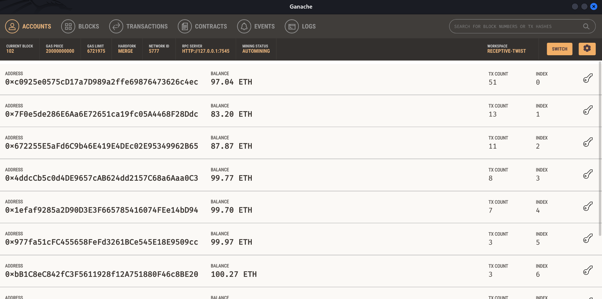
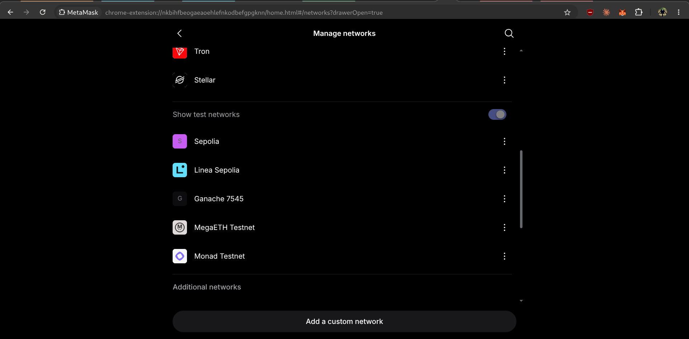
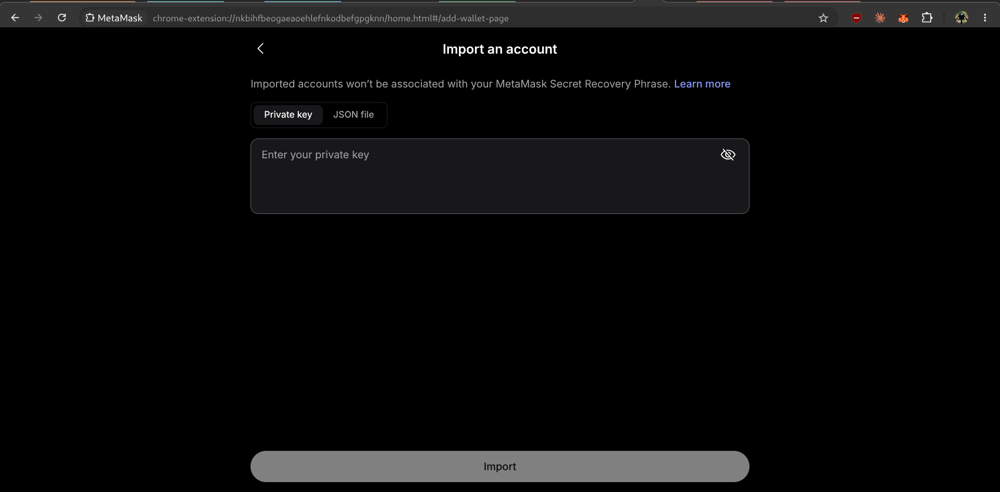
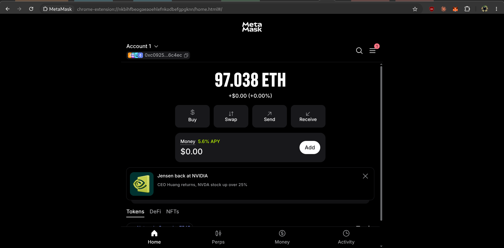
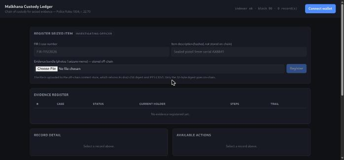
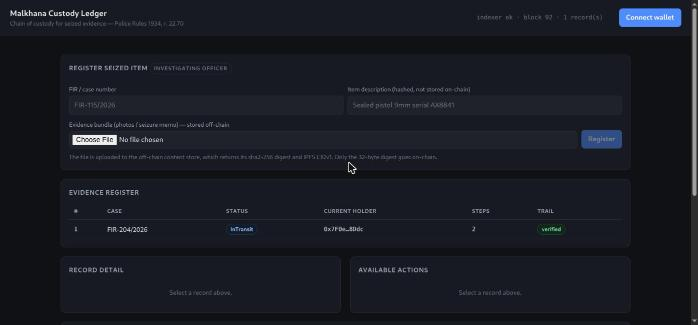
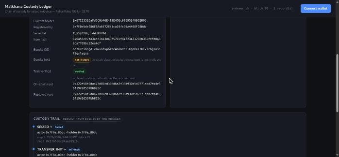
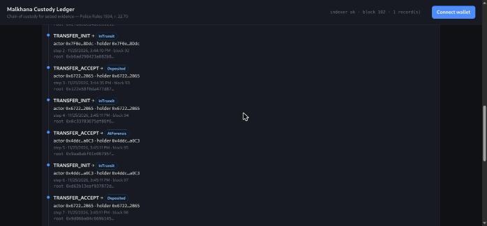
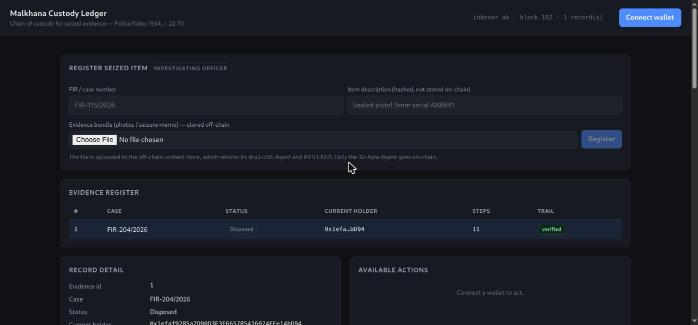

# Demo walkthrough: setup and the flow to show

Blockchain Empowerment Project, Fall 2026. Malkhana Custody Ledger.

This is the runbook for the live demonstration. Part 1 is the setup, Part 2 is
the sequence to perform in front of the examiner, and Part 3 is what to say at
each point.

Every screenshot here is from a real run against Ganache on 25 November 2026,
with the block numbers and gas figures taken from that run.

> Screenshots of the Ganache window and the MetaMask dialogs were taken during a
> practice run on the same day. The Ganache one has its mnemonic cropped out.

## Part 1: Setup

### 1.1 Start Ganache

Launch the Ganache GUI. It opens a workspace on **port 7545** with ten accounts
of 100 ETH each.



Note the port. Ganache's GUI uses 7545 while most tutorials and `ganache-cli`
use 8545, and Remix prefills 8545, which is the usual first thing to go wrong.

Two other fields in that bar matter. **Network ID 5777** is Ganache's own
identifier, while the chain ID MetaMask needs is **1337**; they are different
numbers and MetaMask wants the second. **Hardfork: MERGE** is why the contracts
are compiled with `evmVersion: "paris"`. Paris is the Merge, and anything newer
emits the `PUSH0` opcode, which this version of Ganache does not implement and
rejects as an invalid opcode.

> The mnemonic has been cropped out of this screenshot. Ganache prints the seed
> phrase for all ten accounts at the top of that screen, and the brief requires
> that no private keys or seed phrases are submitted. Crop it from any
> screenshot you add.

### 1.2 Point MetaMask at Ganache

Add a network in MetaMask. Once added it appears in Manage networks:

```
Network name   Ganache 7545
RPC URL        http://127.0.0.1:7545
Chain ID       1337
Currency       ETH
```



Then import the accounts you want to act as. In Ganache, click the key icon on
an account row, copy the private key, and in MetaMask use Import Account.



Once imported and switched to the Ganache network, the account shows its
Ganache balance. This is account 0, the administrator, with its starting 100 ETH
less what it has spent on gas deploying the contracts.



For the full demonstration you need four accounts, because each role is a
different address. The table in 1.4 says which is which.

### 1.3 Deploy the contracts

```bash
cd malkhana-custody-ledger
npm install
npx hardhat run scripts/deploy.js --network ganache
```

Output from the run these screenshots come from:

```
network: ganache
admin:    0xc0925e0575cD17a7D989a2ffe69876473626c4ec
IO:       0x7F0e5de286E6Aa6E72651ca19fc05A4468F28Ddc
malkhana: 0x672255E5aFd6C9b46E419E4DEc02E95349962B65
forensic: 0x4ddcCb5c0d4DE9657cAB624dd2157C68a6Aaa0C3
court:    0x1efaf9285a2D90D3E3F665785416074FEe14bD94

EvidenceRegistry: 0x687d48965428D50a618E023d878aF65434f798FE
CustodyManager:   0xdeE5A13928645cD76d37Fa21CAB96ee7419E8Fc1
CourtOrders:      0x9B847D71290c501b06F2B57C3B4bdAbEde35dbaE

wired custody + court writers
granted ROLE_IO -> 0x7F0e5de286E6Aa6E72651ca19fc05A4468F28Ddc
granted ROLE_MALKHANA -> 0x672255E5aFd6C9b46E419E4DEc02E95349962B65
granted ROLE_FORENSIC -> 0x4ddcCb5c0d4DE9657cAB624dd2157C68a6Aaa0C3
granted ROLE_COURT -> 0x1efaf9285a2D90D3E3F665785416074FEe14bD94

wrote deployments/ganache.json
```

The deploy script does three things: deploys the three contracts, authorises
`CustodyManager` as a custody writer and `CourtOrders` as a court writer, then
grants the four roles.

### 1.4 Who is who

| Ganache account | Role | Can do |
|---|---|---|
| 0 | ADMIN | pause and unpause, grant roles |
| 1 | IO | register a seizure, hand over |
| 2 | MALKHANA | accept, hold, attach documents |
| 3 | FORENSIC | accept for analysis, attach a report |
| 4 | COURT | freeze, resolve, produce, dispose |

### 1.5 Start the off-chain service

```bash
RPC_URL=http://127.0.0.1:7545 NETWORK=ganache node offchain/indexer.js
```

This one process does three jobs: it listens for contract events and rebuilds
the custody trail, it serves the REST API, and it hosts the web interface on
<http://127.0.0.1:3001>.

### 1.6 Open the interface

Open <http://127.0.0.1:3001> and press Connect wallet. The header shows your
address and the roles that address holds, read from the contract itself.



The header reads `indexer ok · block 90 · 0 record(s)`. The register is empty
and the Register button is greyed out until an account with ROLE_IO connects.

## Part 2: The sequence to demonstrate

### Step 1: Register a seizure (as IO)

Switch MetaMask to account 1. Fill in the FIR number and item description,
attach any file as the evidence bundle, and press Register.

The file goes to the off-chain content store, which returns its sha2-256 digest
and IPFS CIDv1. **Only the 32-byte digest goes on-chain.**

```
IO registers FIR-204/2026   (block 91, gas 189,603)
```

### Step 2: Hand it to the malkhana, and stop here

Still as the IO, initiate a transfer to the Malkhana Officer.

```
IO initiates transfer to Malkhana Officer   (block 92, gas 81,457)
```



**This is the first point worth pausing on.** The status is `InTransit`, but the
current holder is still `0x7F0e…8Ddc`, the IO. Custody has not moved. The
handover is two-phase, so an officer cannot push an item onto somebody and then
claim they lost it. The receiver has to accept.

### Step 3: Accept (as the Malkhana Officer)

Switch MetaMask to account 2 and accept.

```
Malkhana Officer accepts custody   (block 93, gas 56,668)
```

Status becomes `Deposited`. Note that the resulting status came from the
**receiver's role**, not from anything the sender claimed.

### Step 4: Open the record. This is the centrepiece

Click the row in the register.



Two things to point at.

**Trail verified.** The on-chain root and the replayed root are identical. The
full custody trail is not stored in contract storage, it lives in events. The
indexer replays those events and recomputes a rolling hash, then compares it
against the `custodyRoot` the contract holds. If a step were omitted, altered or
reordered, the two values would differ and the record would be reported as
unverified. The indexer is not trusted, it proves itself.

**Bundle held: not in store.** The chain has the digest, but this particular
store does not hold the file. The record is still verifiable. That is a failure
condition the system reports honestly rather than hiding.

### Step 5: Forensic round trip

Hand over to the PFSA analyst (account 3), accept, attach a report, hand back,
accept again.

```
Malkhana initiates transfer to PFSA   (block 94, gas 84,600)
PFSA analyst accepts                  (block 95, gas 59,811)
PFSA attaches report                  (block 96, gas 29,492)
PFSA returns to malkhana              (block 97, gas 81,457)
Malkhana accepts back                 (block 98, gas 56,668)
```

The attachment costs only 29,492 gas because it is emitted as an event and
nothing is written to storage. That is gas optimisation 2, and it is also why
attachments are append-only: there is no stored value to overwrite.

### Step 6: Court freezes the record, and movement stops

Switch to account 4 and raise a dispute.

```
Court freezes the record   (block 99, gas 58,027)
```

Now switch back to the Malkhana Officer and try to transfer the item.

```
move while frozen REFUSED
```

The registry refuses with `RecordFrozen`. Only `CourtOrders` can touch a frozen
record, and `CustodyManager` has no authority to do so.

### Step 7: Resolve, produce, dispose

```
Court resolves the dispute   (block 100, gas 57,592)
Court orders production      (block 101, gas 55,313)
Court orders final disposal  (block 102, gas 69,363)
```



Every step carries its actor, the holder after it, the block, and the rolling
root at that point.



Eleven custody steps, status `Disposed`, trail still verified. Try any further
action on it and the registry refuses with `RecordTerminal`.

The full trail:

```
 1. SEIZED           -> Seized
 2. TRANSFER_INIT    -> InTransit
 3. TRANSFER_ACCEPT  -> Deposited
 4. TRANSFER_INIT    -> InTransit
 5. TRANSFER_ACCEPT  -> AtForensic
 6. TRANSFER_INIT    -> InTransit
 7. TRANSFER_ACCEPT  -> Deposited
 8. DISPUTE_RAISE    -> Disputed
 9. DISPUTE_RESOLVE  -> Deposited
10. COURT_PRODUCE    -> InCourt
11. COURT_DISPOSE    -> Disposed
```

### Step 8: The emergency stop (as ADMIN)

Switch to account 0 and press Pause.

```
Pause system   (block 80, gas 46,857)
```

Then read the three contracts straight off the chain:

```
EvidenceRegistry.paused()   TRUE
CustodyManager.paused()     TRUE
CourtOrders.paused()        TRUE
```

**This is the best single moment for criterion B.** `CustodyManager` and
`CourtOrders` store no pause flag of their own. Their `paused()` is a `virtual`
method overridden to read `EvidenceRegistry`. One admin transaction froze all
three contracts, because there is one authority rather than three copies that
could drift apart. The same trick is used for `hasRole()`, which is why an
officer is granted a role once rather than three times.

While paused, every write is refused and every read still works. An ongoing
investigation stays inspectable during an incident.

Press Unpause to finish.

## Part 3: What to say

Short answers for the questions most likely to come up during the demo. The
longer versions are in `docs/VIVA-DEFENCE.md`.

**Why not just a database?** A database with audit logging would deliver most of
this. The property it cannot deliver is the one the problem needs: in malkhana
the custodian is the adversary. Register No. XIX is a paper book kept by the
same officer whose conduct is questioned, and the defence cannot verify it.
Changing the medium to Postgres does not change who controls it. The case for a
chain rests on several mutually distrusting institutions sharing one record that
none of them owns.

**Could you use Ethereum?** Not mainnet: gas costs real money, case metadata
would be public forever, and a global validator set should not order Pakistani
criminal evidence. We wrote Solidity so the contracts are portable, and
production would be a permissioned EVM chain such as Hyperledger Besu.

**What consensus does this use?** Ganache auto-mines, so strictly it has none,
and that is a development convenience rather than a design choice. Production
would use QBFT, a Byzantine fault tolerant Proof of Authority protocol, chosen
for immediate deterministic finality, because a court cannot rely on a block
that will probably not be reverted. It tolerates `f` faults in `3f + 1`
validators, the same bound as the Byzantine Generals problem.

**Why three contracts?** Capability separation. `CustodyManager` is authorised
only as a custody writer, so it is structurally incapable of freezing or
destroying evidence even if compromised, and the admin can revoke it in one
call.

**How do I know the indexer is telling the truth?** You do not have to trust it.
It holds no keys and cannot write to the chain. Every record it serves carries
the on-chain root and its own recomputed root, and anyone can run their own
indexer against the same public events.

## Reproducing the evidence

```bash
npx hardhat test                            # 50 tests, 26 of them negative
npx hardhat run scripts/gas-benchmark.js    # regenerates docs/GAS-EVALUATION.md
npx hardhat run scripts/storage-layout.js   # proves the struct packing
node offchain/cid.js                        # CIDv1 self-test against a public vector
```
